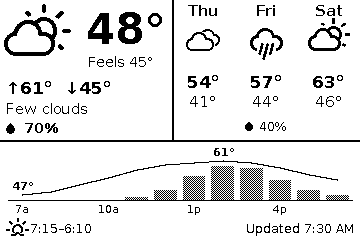
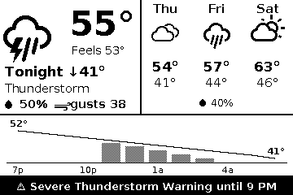

# ePaper Weather Station

A small, always-on weather display you can mount anywhere. Every 15 minutes, a Raspberry Pi Zero pulls the forecast from OpenWeather and draws it on a Waveshare 3.52" e-Paper screen: current conditions with icons, a 3-day outlook, the next 12 hours of temperature and rain, and any active weather warnings. E-paper holds its image with no power, so the screen stays readable between updates and through network outages.

<p>
  
  
</p>


## What's on the screen

| Area | Shows |
| --- | --- |
| **Top left** | Current conditions icon, temperature, and feels-like. Before evening: today's high and low. After 6pm: tonight's low and overnight rain chance. |
| **Callouts** | Rain chance, wind, and UV, each shown only when it crosses a threshold you can set. On a calm day the line stays empty. |
| **Top right** | The next three days: icon, high, low, and rain chance when it's 10% or more. |
| **Middle** | The next 12 hours: a temperature line over shaded rain-chance bars, so you can see *when* it will rain, not only whether it will. |
| **Footer** | Sunrise and sunset, or "↓14° colder tomorrow" when tomorrow's high swings by 10° or more. A black banner replaces the footer for an active government weather alert, or when the station is offline. |

The station makes one API call per update and stays well within OpenWeather's free tier.

## What you need

| Part | Notes |
| --- | --- |
| Raspberry Pi Zero W or Zero 2 W | Any Pi with a 40-pin header and Wi-Fi works. |
| microSD card, 8 GB or larger | |
| [Waveshare 3.52" e-Paper HAT](https://www.waveshare.com/3.52inch-e-paper-hat.htm) | Monochrome, 360 × 240. Plugs straight onto the GPIO header. |
| OpenWeather account | Free. See step 1. |
| Case | Optional. The Adafruit Pi Zero case fits. |

## Setup

### 1. Get an OpenWeather API key

1. Create a free account at [openweathermap.org](https://home.openweathermap.org/users/sign_up).
2. Subscribe to **One Call API 3.0**. OpenWeather asks for a card, but the first 1,000 calls per day are free, and this station makes at most 97. To guarantee you're never billed, set your daily call limit to 1,000 under **Billing plans**.
3. Copy your key from [API keys](https://home.openweathermap.org/api_keys). New keys can take a couple of hours to activate.

### 2. Flash the SD card

1. In [Raspberry Pi Imager](https://www.raspberrypi.com/software/), choose **Raspberry Pi OS Lite**.
2. Open the OS customization settings. Set a hostname, username, and password, enter your Wi-Fi details, and enable SSH.
3. Write the card, put it in the Pi, attach the display, and power up. Give it a few minutes to join your network.

### 3. Install

SSH in, using the hostname you chose:

```sh
ssh your-username@your-hostname.local
```

Then run:

```sh
sudo apt install -y git
git clone https://github.com/Rocky56gh9/ePaper-Weather-Station.git
cd ePaper-Weather-Station
./install.sh
```

The installer:

- installs the Python packages from Raspberry Pi OS,
- enables SPI,
- asks for your API key, latitude, longitude, and units, and saves them to `config.ini`,
- schedules an update every 15 minutes and a deep clean at 1:10am,
- draws the first forecast.

If it just enabled SPI, it asks you to reboot first. The display then updates within 15 minutes.

To find your coordinates, right-click your location in Google Maps and click the numbers at the top of the menu to copy them.

## Settings

Edit `config.ini` with `nano config.ini`. Changes apply at the next update.

| Setting | Default | What it does |
| --- | --- | --- |
| `units` | `imperial` | `imperial` (°F, mph) or `metric` (°C, m/s). |
| `quiet_hours` | `0-5` | Hours to leave the display alone, as start-end on a 24-hour clock. `23-6` works too. Leave blank to update around the clock. |
| `evening_starts` | `18` | Hour the top-left panel switches from today to tonight. |
| `wind`, `gusts` | 15 / 25 mph (7 / 11 m/s) | Show a wind callout at or above these speeds. |
| `uv_index` | `6` | Show a UV callout at or above this index. |
| `temp_swing` | 10°F (6°C) | Show "colder/warmer tomorrow" when tomorrow's high differs from today's by this much. |

## Using it

| Task | Command |
| --- | --- |
| Update the display now, even in quiet hours | `python3 weather_station.py --force` |
| Clear ghosting manually | `python3 weather_station.py --deep-clean` |
| View logs | `journalctl -t epaper-weather` |
| Get the latest version | `git pull` |

**When the network is down**, the station redraws its last good forecast under an **OFFLINE** banner that shows when that forecast was fetched. The 12-hour chart and day names stay correct as time passes, and it skips refreshes that wouldn't change anything.

**The nightly deep clean** cycles every pixel black and white twice to clear any faint ghosting, then draws the forecast. It runs at 1:10am even during quiet hours. Every regular update also does a full-screen refresh, so ghosting rarely builds up.

## Customizing the layout

Try layout changes on your computer first. No Pi or API key needed:

```sh
pip install pillow requests
python3 weather_station.py --demo --preview preview.png
```

`--demo` renders a fixed moment from `sample_data.json`, and `--preview` saves the screen as a PNG. The layout lives in `layout.py`. The canvas is 360 × 240 pixels, and black and white are the only colors. Icons come from the [Weather Icons](https://erikflowers.github.io/weather-icons/) font, where each icon is a character.

Run the tests after changes:

```sh
python3 -m unittest discover tests
```

## Troubleshooting

| Symptom | Fix |
| --- | --- |
| `OpenWeather rejected the API key (401)` | Check that your account has the **One Call API 3.0** subscription, not only the free current-weather API. New keys can take a couple of hours to activate. |
| `No such file or directory: '/dev/spidev0.0'` | SPI is off. Run `sudo raspi-config nonint do_spi 0`, then reboot. |
| Display never changes | Check `journalctl -t epaper-weather` for errors, and confirm you're outside your quiet hours. Then check that the HAT is fully seated on all 40 pins. |
| `config.ini not found` | Run `./install.sh`, or `cp config.example.ini config.ini` and edit it. |

## Project layout

```
weather_station.py   fetching, caching, scheduling rules, and the display driver calls
layout.py            draws the screen
install.sh           one-time setup on the Pi
config.example.ini   settings template (config.ini is created from it and git-ignored)
sample_data.json     fixed sample forecast for --demo and the tests
tests/               behavior tests; no hardware or network needed
waveshare_epd/       Waveshare's display driver, unmodified (MIT, see file headers)
fonts/               DejaVu Sans and Weather Icons (free licenses, see fonts/LICENSE-*)
```

## License

MIT. See [LICENSE](LICENSE). The bundled Waveshare driver and fonts keep their own licenses.
