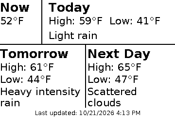
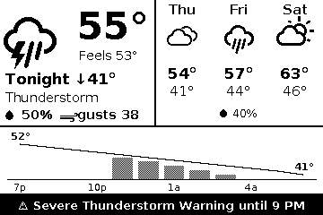
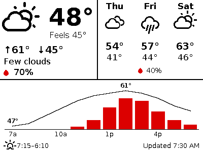
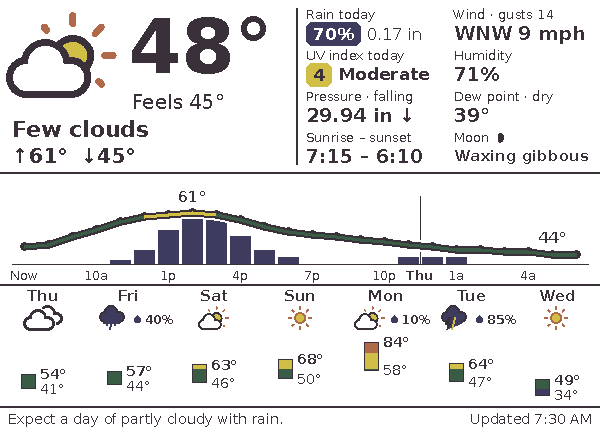
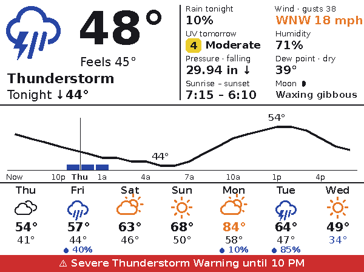

# ePaper Weather Station

A small, always-on weather display you can mount anywhere. Every 15 minutes, a Raspberry Pi Zero pulls the forecast from OpenWeather and draws it on an e-Paper screen (a Waveshare 3.52" HAT, a Pimoroni Inky wHAT, or the 7-color Pimoroni Inky Impression 5.7"): current conditions with icons, the days ahead, the hours ahead with temperature and rain, and any active weather warnings. E-paper holds its image with no power, so the screen stays readable between updates and through network outages.

<p>
  
  
</p>

<p>
  
  
</p>

<p>
  
  
</p>

## What's on the screen

### Waveshare 3.52" and Inky wHAT

| Area | Shows |
| --- | --- |
| **Top left** | Current conditions icon, temperature, and feels-like. Before evening: today's high and low. After 6pm: tonight's low and overnight rain chance. |
| **Callouts** | Rain chance, wind, and UV, each shown only when it crosses a threshold you can set. On a calm day the line stays empty. |
| **Top right** | The next three days: icon, high, low, and rain chance when it's 10% or more. |
| **Middle** | The next 12 hours: a temperature line over shaded rain-chance bars, so you can see *when* it will rain, not only whether it will. |
| **Footer** | Sunrise and sunset, or "↓14° colder tomorrow" when tomorrow's high swings by 10° or more. A black banner replaces the footer for an active government weather alert, or when the station is offline. |

### Inky Impression 5.7"

The larger color screen has its own layout. It shows more of the forecast, and uses color to make it quicker to read.

| Area | Shows |
| --- | --- |
| **Top left** | Current conditions icon, temperature, feels-like, and description. Before evening: today's high and low. After 6pm: tonight's low. |
| **Top right** | A details grid: rain chance and amount, wind direction and speed with gusts, UV index, humidity, pressure and its 3-hour trend, dew point with a comfort word, sunrise and sunset, and the moon phase. |
| **Middle** | The next **24 hours**: a temperature line over rain-chance bars, with the day name marking midnight. |
| **Lower** | The next **7 days**: icon, high, low, and rain chance when it's 10% or more. |
| **Footer** | OpenWeather's one-line summary of the day ("Expect a day of partly cloudy with rain"), or "↓14° colder tomorrow" for a big swing. A red banner for active government weather alerts; a black one when offline. |

Each color has a fixed meaning:

| Color | Means |
| --- | --- |
| Blue | Rain and snow (chart bars, rain chances, wet-weather icons) and cold temperatures: 40°F / 4°C or below |
| Orange | Sun icons, warm temperatures (80°F / 27°C and up), and wind above your `wind` or `gusts` setting |
| Red | Hot temperatures (90°F / 32°C and up) and government weather alerts |
| Green, yellow, orange, red | The UV index badge: low, moderate, high, very high |

Every color is one of the panel's seven pure inks, so nothing is dithered.

The station makes one API call per update and stays well within OpenWeather's free tier, whichever screen you use.

## What you need

| Part | Notes |
| --- | --- |
| Raspberry Pi Zero W or Zero 2 W | Any Pi with a 40-pin header and Wi-Fi works. |
| microSD card, 8 GB or larger | |
| A supported display (see below) | Plugs straight onto the GPIO header. |
| OpenWeather account | Free. See step 1. |
| Case | Optional. The Adafruit Pi Zero case fits. |

### Supported displays

| Display | Resolution | Colors | `screen =` |
| --- | --- | --- | --- |
| [Waveshare 3.52" e-Paper HAT](https://www.waveshare.com/3.52inch-e-paper-hat.htm) | 360 × 240 | Black, white | `waveshare_3in52` |
| [Pimoroni Inky wHAT](https://shop.pimoroni.com/products/inky-what) | 400 × 300 | Black, white, and red or yellow (black-and-white also works) | `inky_what` |
| [Pimoroni Inky Impression 5.7"](https://shop.pimoroni.com/products/inky-impression-5-7) | 600 × 448 | 7 colors | `inky_impression_5in7` |

The Waveshare and wHAT share one layout that scales to each screen; on the wHAT the extra height goes to the 12-hour chart, and on red or yellow boards the accent color marks rain, weather alerts, and big temperature swings. The Impression has its own layout (see above).

Color e-paper refreshes more slowly than black and white. Expect a longer flashing sequence on the wHAT, and about 30 seconds of color cycling on the Impression. That's normal; it's how the panel sets each ink.

## Setup

### 1. Get an OpenWeather API key

1. Create a free account at [openweathermap.org](https://home.openweathermap.org/users/sign_up).
2. Subscribe to **One Call API 3.0**. OpenWeather asks for a card, but the first 1,000 calls per day are free, and this station makes at most 97. To guarantee you're never billed, set your daily call limit to 1,000 under **Billing plans**.
3. Copy your key from [API keys](https://home.openweathermap.org/api_keys). New keys can take a couple of hours to activate.

### 2. Flash the SD card

1. In [Raspberry Pi Imager](https://www.raspberrypi.com/software/), choose **Raspberry Pi OS Lite**.
2. Open the OS customization settings. Set a hostname, username, and password, enter your Wi-Fi details, and enable SSH.
3. Write the card, put it in the Pi, attach the display, and power up. Give it a few minutes to join your network.

### 3. Install

SSH in, using the hostname you chose:

```sh
ssh your-username@your-hostname.local
```

Then run:

```sh
sudo apt install -y git
git clone https://github.com/Rocky56gh9/ePaper-Weather-Station.git
cd ePaper-Weather-Station
./install.sh
```

The installer:

- installs the Python packages from Raspberry Pi OS,
- asks which display is attached,
- enables SPI (and for Inky boards, I2C plus the `spi0-0cs` boot overlay, after backing up `config.txt`),
- installs Pimoroni's `inky` library into a project virtual environment when you use an Inky,
- asks for your API key, latitude, longitude, and units, and saves them to `config.ini`,
- schedules an update every 15 minutes and a deep clean at 1:10am,
- draws the first forecast.

If it just enabled SPI, it asks you to reboot first. The display then updates within 15 minutes.

To find your coordinates, right-click your location in Google Maps and click the numbers at the top of the menu to copy them.

## Settings

Edit `config.ini` with `nano config.ini`. Changes apply at the next update.

| Setting | Default | What it does |
| --- | --- | --- |
| `screen` | `waveshare_3in52` | Which display is attached: `waveshare_3in52`, `inky_what`, or `inky_impression_5in7`. Rerun `./install.sh` after changing it. |
| `rotate` | `0` | `180` if the display is mounted upside down. |
| `units` | `imperial` | `imperial` (°F, mph) or `metric` (°C, m/s). |
| `quiet_hours` | `0-5` | Hours to leave the display alone, as start-end on a 24-hour clock. `23-6` works too. Leave blank to update around the clock. |
| `evening_starts` | `18` | Hour the top-left panel switches from today to tonight. |
| `wind`, `gusts` | 15 / 25 mph (7 / 11 m/s) | Show a wind callout at or above these speeds (on the Impression, the wind turns orange). |
| `uv_index` | `6` | Show a UV callout at or above this index. |
| `temp_swing` | 10°F (6°C) | Show "colder/warmer tomorrow" when tomorrow's high differs from today's by this much. |

## Using it

`install.sh` schedules the updates for you, so there's nothing to start by hand. Run these from the project folder (`cd ~/ePaper-Weather-Station`):

| Task | Command |
| --- | --- |
| Update the display now, even in quiet hours | `.venv/bin/python weather_station.py --force` |
| Clear ghosting manually | `.venv/bin/python weather_station.py --deep-clean` |
| View logs | `journalctl -t epaper-weather` |
| See the schedule | `crontab -l` (two lines ending in `# epaper-weather-station`) |
| Get the latest version | `git pull` |

**Which Python to use:** on an Inky display, the installer usually puts Pimoroni's `inky` library in a project virtual environment, `.venv`, and the commands above use its Python. If your project folder has no `.venv` (the Waveshare 3.52", or an Inky whose library was already installed system-wide), use `python3` instead. `crontab -l` shows which one the schedule uses.

**When the network is down**, the station redraws its last good forecast under an **OFFLINE** banner that shows when that forecast was fetched. The hourly chart and day names stay correct as time passes, and it skips refreshes that wouldn't change anything.

**The nightly deep clean** cycles every pixel black and white twice to clear any faint ghosting, then draws the forecast. The Impression already runs a full cleaning cycle on every refresh, so its deep clean is a single pass of black, white, and the panel's clean mode, about two minutes in all. It runs at 1:10am even during quiet hours. Every regular update also does a full-screen refresh, so ghosting rarely builds up.

## Customizing the layout

Try layout changes on your computer first. No Pi or API key needed:

```sh
pip install pillow requests
python3 weather_station.py --demo --preview preview.png
```

`--demo` renders a fixed moment from `sample_data.json`, and `--preview` saves the screen as a PNG. Add `--screen inky_what` or `--screen inky_impression_5in7` to preview another screen. Preview colors approximate the real inks, which are softer on the panel.

Each screen is a profile in `displays/__init__.py` that names its size and layout:

| Layout | Screens | Notes |
| --- | --- | --- |
| `layouts/compact.py` | Waveshare 3.52", Inky wHAT | Positions written for 360 × 240 and scaled. Three palette colors: white, black, and an accent that black-and-white screens draw as black. |
| `layouts/impression.py` | Inky Impression 5.7" | Positions written for 600 × 448. Seven palette colors in the panel's own ink order, so the driver sends them unchanged. |

Shared code (fonts, icons, the forecast resolved against the current time) is in `layouts/common.py`. To support a new screen, add a driver in `displays/`, a profile in `displays/__init__.py`, and either reuse a layout or write a new one. Icons come from the [Weather Icons](https://erikflowers.github.io/weather-icons/) font, where each icon is a character.

Run the tests after changes:

```sh
python3 -m unittest discover tests
```

## Troubleshooting

| Symptom | Fix |
| --- | --- |
| `OpenWeather rejected the API key (401)` | Check that your account has the **One Call API 3.0** subscription, not only the free current-weather API. New keys can take a couple of hours to activate. |
| `No such file or directory: '/dev/spidev0.0'` | SPI is off. Run `sudo raspi-config nonint do_spi 0`, then reboot. |
| Display never changes | Check `journalctl -t epaper-weather` for errors, and confirm you're outside your quiet hours. Then check that the HAT is fully seated on all 40 pins. |
| `config.ini not found` | Run `./install.sh`, or `cp config.example.ini config.ini` and edit it. |
| `No module named 'inky'` | You ran the station with the system `python3`, but `inky` is installed in the project's `.venv`. Use `.venv/bin/python weather_station.py` instead (see [Using it](#using-it)). |
| Inky: `Chip Select: (line 8, GPIO8) currently claimed by spi0 CS0` | Add `dtoverlay=spi0-0cs` to `/boot/firmware/config.txt` (or `/boot/config.txt` on older systems) and reboot. `install.sh` does this for you. |
| Inky: `No EEPROM detected!` | Check that I2C is on (`sudo raspi-config nonint do_i2c 0`) and the board is fully seated, then reboot. |
| `Found a 800x480 Inky, but screen = inky_impression_5in7 draws 600x448` | The board is a different Inky Impression size than `screen` says. Only the 5.7" is supported so far. |

## Project layout

```
weather_station.py   fetching, caching, scheduling rules, and the display driver calls
layouts/             one layout per screen family, plus shared drawing code
displays/            one driver per supported screen, and the screen profiles
install.sh           one-time setup on the Pi
config.example.ini   settings template (config.ini is created from it and git-ignored)
sample_data.json     fixed sample forecast for --demo and the tests
tests/               behavior tests; no hardware or network needed
waveshare_epd/       Waveshare's display driver, unmodified (MIT, see file headers)
fonts/               DejaVu Sans and Weather Icons (free licenses, see fonts/LICENSE-*)
```

## License

MIT. See [LICENSE](LICENSE). The bundled Waveshare driver and fonts keep their own licenses.
